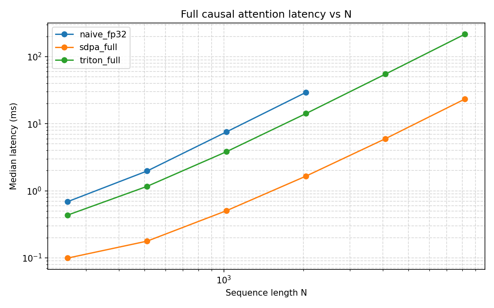
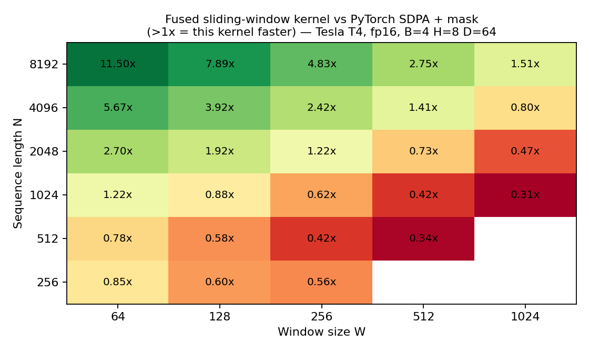
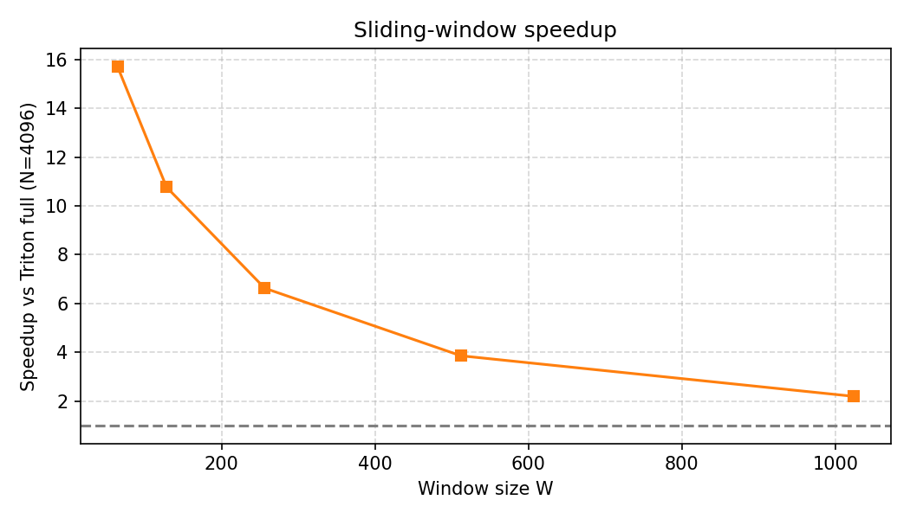
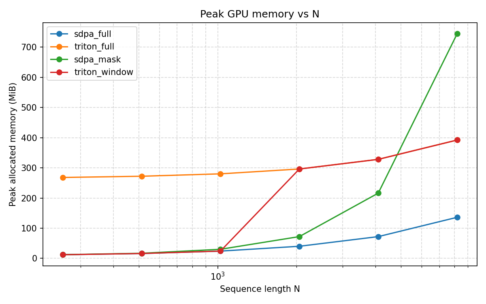

# triton-swa-turing

**Fused sliding-window attention kernels in Triton for NVIDIA Turing (sm_75 / Tesla T4), with a measured-latency study of an RL attention router.**

A tiled, online-softmax attention forward kernel (fp16 in, fp32 accumulate) that serves both **full causal** and **sliding-window** attention from a single `@triton.jit` function. Out-of-window KV blocks are never loaded, so cost scales with `O(N·W)` instead of `O(N²)`. Built and benchmarked on a Tesls Colab T4, where FlashAttention-2 and PyTorch's flash SDPA backend do not run (they need sm80+).

[](TODO-colab-link)
-76b900)


**Topics:** `triton` `cuda` `gpu-kernels` `flashattention` `sliding-window-attention` `attention` `pytorch` `turing` `t4` `benchmarking`

> **Status: v0.1, forward pass only.** Correctness is thoroughly tested. The fused window kernel beats PyTorch SDPA-with-mask when the window is small relative to the sequence (about `W <= N/8` on this GPU). The full-attention path is about 9x **slower** than PyTorch's memory-efficient SDPA at long N, and kernel efficiency is being investigated. All numbers below come from the files in [`results/`](results/).

---

## Table of contents

1. [Kernel design](#kernel-design)
2. [Kernel benchmarks](#kernel-benchmarks)
3. [Router integration: measured latency](#router-integration-measured-latency)
4. [Installation and usage](#installation-and-usage)
5. [Reproducing the results](#reproducing-the-results)
6. [Repository layout](#repository-layout)
7. [Environment](#environment)
8. [References](#references)
9. [License](#license)

---

## Kernel design

One kernel (`kernels/attention_fwd.py`) handles both modes. **Full causal attention is the special case `WINDOW >= N`.**

```
KV axis ->  0 ........ lo ................ hi ........ N
Q block m:             [== blocks actually loaded ==]
                       ^ max(0, q_start - W + 1),      ^ causal bound
                         aligned down to BLOCK_N
Everything left of `lo` is never read from HBM.
```

- **Grid:** `(cdiv(N, BLOCK_M), B*H)`; each program owns one Q block of one batch-head.
- **Online softmax:** running max `m_i` and running sum `l_i`; the accumulator is rescaled by `alpha = exp2(m_old - m_new)` per KV block. The `N x N` score matrix never touches HBM.
- **Mask value `-1e6`, not `-inf`:** if a row's first visited block is entirely outside its window, `-inf - (-inf)` would produce NaN. With `-1e6` the bogus partial sums are multiplied by `alpha ~ 0` as soon as a real key arrives, and each row's own diagonal block always contains one.
- **`log2(e)` folded into the scale** so the inner loop uses `tl.exp2`.
- **fp16 inputs, fp32 accumulators** (T4 has no bf16).
- **Autotune** over `BLOCK_M/BLOCK_N in {32, 64, 128}`, `num_warps in {2, 4, 8}`, `num_stages in {1, 2}`; keyed on `(N, WINDOW, HEAD_DIM)`.
- **Window semantics:** the router's mask is inclusive `[i-W, i]` (length `W+1`), so the kernel is called with `window = W + 1`. Window `1` returns `V` exactly.

---

## Kernel benchmarks

**Setup:** Tesla T4, fp16, `B=4, H=8, D=64`, CUDA-event timing with warmup, median of repeated runs (p25/p75 are in the CSV). Raw data: [`results/kernel_bench.csv`](results/kernel_bench.csv).

FLOP counts used for TFLOPS: full causal `2*B*H*N^2*D`; window `4*B*H*N*min(W,N)*D`.

### 1. Full causal attention

| N | naive fp32 (ms) | SDPA (ms) | This kernel (ms) | SDPA TFLOPS | This kernel TFLOPS | Slowdown vs SDPA |
|---:|---:|---:|---:|---:|---:|---:|
| 256 | 0.689 | 0.099 | 0.434 | 2.71 | 0.62 | 4.4x |
| 512 | 1.972 | 0.177 | 1.164 | 6.06 | 0.92 | 6.6x |
| 1024 | 7.568 | 0.505 | 3.834 | 8.51 | 1.12 | 7.6x |
| 2048 | 29.387 | 1.655 | 14.188 | 10.38 | 1.21 | 8.6x |
| 4096 | skipped (memory) | 5.984 | 54.974 | 11.48 | 1.25 | 9.2x |
| 8192 | skipped (memory) | 23.353 | 216.590 | 11.77 | 1.27 | 9.3x |



**Observation notes:** the kernel is correct and beats the naive fp32 reference, but it is far from PyTorch's memory-efficient SDPA, and its achieved TFLOPS is nearly constant (about 1.2) across N, versus about 11-12 for SDPA. A flat, low plateau is what you would expect if the inner `tl.dot` is not hitting tensor cores on sm_75 with this Triton version. **No full-attention speedup is claimed.**

### 2. Sliding-window kernel vs. PyTorch SDPA with an explicit mask

Speedup = `SDPA+mask ms / this kernel ms` (above 1.00x means this kernel is faster). Bold marks wins.

| N \ W | 64 | 128 | 256 | 512 | 1024 |
|---:|---:|---:|---:|---:|---:|
| 256 | 0.85x | 0.60x | 0.56x | n/a | n/a |
| 512 | 0.78x | 0.58x | 0.42x | 0.34x | n/a |
| 1024 | **1.22x** | 0.88x | 0.62x | 0.42x | 0.31x |
| 2048 | **2.70x** | **1.92x** | **1.22x** | 0.73x | 0.47x |
| 4096 | **5.67x** | **3.92x** | **2.42x** | **1.41x** | 0.80x |
| 8192 | **11.50x** | **7.89x** | **4.83x** | **2.75x** | **1.51x** |



Raw latencies for the two longest sequences (median ms):

| N | W | This kernel | SDPA + mask |
|---:|---:|---:|---:|
| 4096 | 64 | 3.498 | 19.849 |
| 4096 | 128 | 5.106 | 20.001 |
| 4096 | 256 | 8.298 | 20.062 |
| 4096 | 512 | 14.262 | 20.079 |
| 4096 | 1024 | 25.076 | 20.009 |
| 8192 | 64 | 6.992 | 80.395 |
| 8192 | 128 | 10.168 | 80.267 |
| 8192 | 256 | 16.591 | 80.140 |
| 8192 | 512 | 29.202 | 80.373 |
| 8192 | 1024 | 53.235 | 80.512 |

Observations:

- **SDPA+mask latency is flat in W** (N=4096: 19.8-20.1 ms for every W). It does dense `O(N^2)` work and just masks it, which is exactly the cost a fused kernel avoids.
- **Break-even is roughly `W ~ N/8`** on this GPU (wins at N=1024/W=64, N=2048/W<=256, N=4096/W<=512, N=8192/W<=1024). Below that ratio, the kernel's low per-FLOP efficiency (see below) outweighs the skipped work.
- **At short N (<= 512) it loses** to SDPA+mask in every measured cell: launch and tile overheads dominate.
- **Efficiency caveat:** at N=4096, W=64 the window kernel is only 1.7x faster than SDPA *full* causal attention (3.498 vs 5.984 ms) while doing about 32x less arithmetic. Window-kernel throughput is 0.61 TFLOPS at N=8192, W=64 and 1.29 TFLOPS at W=1024.

### 3. Window speedup relative to this repo's own full kernel



This plot shows how window cost scales with `W` (about 15.7x at W=64 down to about 2.2x at W=1024 for N=4096). Treat it as a **scaling-shape plot only**: the reference here is this repo's own slow full-attention kernel, so it is not a headline speedup. Use the SDPA+mask table above for any external comparison.

### 4. Peak memory



| N | SDPA full (MiB) | SDPA + mask (MiB) | Triton full (MiB) | Triton window (MiB) |
|---:|---:|---:|---:|---:|
| 256 | 12 | 12 | 268 | 183 |
| 512 | 16 | 17 | 272 | 208 |
| 1024 | 24 | 30 | 280 | 229 |
| 2048 | 40 | 72 | 296 | 296 |
| 4096 | 72 | 216 | 328 | 328 |
| 8192 | 136 | 744 | 392 | 392 |

**Do not draw conclusions about Triton memory from this table.** The Triton numbers look contaminated by earlier allocations: they are about 268 MiB at N=256 where the inputs total about 4 MiB. The SDPA+mask growth (72 to 744 MiB between N=2048 and 8192) is consistent with a materialised mask, but all rows should be re-measured with `torch.cuda.reset_peak_memory_stats()` before each run.

---

## Router integration: measured latency

The kernels were plugged into a **Hybrid Attention Router**: a PPO agent that chooses, per layer, between **Full (0)**, **Sliding (1)** and **Linear (2)** attention. The goal was to replace a simulated/FLOPs-proxy latency in its reward with **measured** GPU latency.

| Router config | Value |
|---|---|
| Layers | 6 |
| `n_embd` / `n_head` | 128 / 4 (head_dim 32) |
| Context length | 256 |
| Sliding window | 64 (inclusive mask, length 65; kernel called with `window=65`) |
| Linear attention | Performer-style, `feature_dim=64` |
| Actions | 0 = Full, 1 = Sliding, 2 = Linear |

### Per-block latency table (LUT)

One full transformer block (attention + MLP + LayerNorms), CUDA-event timing, eager PyTorch. Embedding + LM-head overhead measured once: **3.8664 ms**. Raw data: [`results/latency_lut.csv`](results/latency_lut.csv).

| B | N | Full (ms) | Sliding (ms) | Linear (ms) |
|---:|---:|---:|---:|---:|
| 1 | 64 | 0.691 | 0.858 | 1.174 |
| 1 | 128 | 0.524 | 0.535 | 0.682 |
| 1 | 256 | 0.547 | 0.537 | 0.793 |
| 1 | 512 | 0.545 | 0.584 | 0.901 |
| 4 | 64 | 0.567 | 0.561 | 0.726 |
| 4 | 128 | 0.551 | 0.544 | 0.746 |
| **4** | **256** | **0.542** | **0.537** | **0.751** |
| 4 | 512 | 0.720 | 0.569 | 0.772 |

At the router's training length (`B=4, N=256`), **Full and Sliding are indistinguishable (0.542 vs 0.537 ms) and Linear is about 39% slower (0.751 ms)**. A FLOPs proxy would rank Linear cheapest. The measured gap is launch-overhead-bound (eager mode, short sequences, extra kernels for the feature map) and would likely change under CUDA graphs or `torch.compile`. Most entries sit near a ~0.54 ms floor, so differences of about 0.01 ms between Full and Sliding are within noise.

### End-to-end evaluation

End-to-end forward latency (CUDA events; p25/p75 from [`results/router_eval.csv`](results/router_eval.csv)), `B=4, N=256`:

| Policy | Actions (per layer) | Latency (ms) | p25 - p75 | Loss | Perplexity |
|---|---|---:|---|---:|---:|
| all_full | `[0,0,0,0,0,0]` | 6.226 | 6.144 - 6.355 | 10.996 | 59,657 |
| all_sliding | `[1,1,1,1,1,1]` | 6.272 | 6.040 - 6.465 | 10.991 | 59,317 |
| all_linear | `[2,2,2,2,2,2]` | 7.184 | 7.100 - 7.246 | 10.992 | 59,405 |
| random_0 | `[2,1,1,0,0,0]` | 6.532 | 6.377 - 6.644 | 10.994 | 59,535 |
| random_1 | `[0,0,0,2,1,2]` | 6.724 | 6.593 - 6.877 | 10.993 | 59,444 |
| random_2 | `[1,1,2,2,1,1]` | 6.710 | 6.535 - 6.912 | 10.982 | 58,825 |
| random_3 | `[1,2,0,2,2,0]` | 6.906 | 6.707 - 8.835 | 10.984 | 58,925 |
| random_4 | `[1,2,1,0,2,2]` | 7.837 | 7.589 - 8.109 | 10.992 | 59,373 |
| **trained_router** | `[0,0,0,0,2,0]` | **7.371** | 7.237 - 7.856 | 10.988 | 59,186 |

Loss is about 10.99 for every policy (chance level for the model's vocabulary), confirming that quality is not being measured. The trained router (one Linear layer) is **slower than all-Full, all-Sliding and several random policies**.

### Does the LUT predict end-to-end latency?

Predicted = sum of per-layer LUT latencies at `B=4, N=256` plus the 3.8664 ms embedding/head overhead (computed directly from the two CSVs):

| Policy | LUT prediction (ms) | Measured (ms) | Error |
|---|---:|---:|---:|
| all_full | 7.12 | 6.23 | +14.3% |
| all_sliding | 7.09 | 6.27 | +13.0% |
| all_linear | 8.37 | 7.18 | +16.5% |
| random_0 | 7.32 | 6.53 | +12.0% |
| random_1 | 7.53 | 6.72 | +12.0% |
| random_2 | 7.51 | 6.71 | +12.0% |
| random_3 | 7.74 | 6.91 | +12.1% |
| random_4 | 7.73 | 7.84 | -1.3% |
| trained_router | 7.33 | 7.37 | -0.6% |

Rank correlation between prediction and measurement over these 9 policies: **Spearman rho = 0.73** (p = 0.025). The table over-predicts by about 12-17% for seven policies (consistent with launch overlap in end-to-end runs) but matches for two (`random_4`, `trained_router`), which also measured slower than their neighbours. Timing variance at the 1 ms scale appears comparable to the differences being studied, so these rankings should be treated as indicative until measurements are repeated with interleaved ordering.

### PPO training (1 seed, 20 epochs)

Data: [`results/history_seed0.json`](results/history_seed0.json), checkpoint `router_seed0.pt`.

- Average reward moved from 0.033 (epoch 1) to 0.045 (epoch 20); the mean of the first 5 epochs is 0.0369 and of the last 5 is 0.0469. Per-epoch values fluctuate between 0.0295 and 0.0459, so this is **not** evidence of convergence.
- Each logged epoch contains **4 decisions** (`n_steps = 4`; action counts sum to 4), while evaluation policies have 6 layers. This mismatch needs to be explained or fixed.
- Episodes with all-Linear actions (epochs 1 and 17) had some of the **highest** step rewards (0.047 and 0.050), even though Linear is the slowest variant in the LUT. As configured, the reward does not appear to prefer the measured-fast choices.

**Takeaway:** the measured-latency pipeline (LUT, evaluation, PPO loop) works end to end, and the LUT yields a ranking that differs from a FLOPs proxy at N=256. The PPO run itself is too short and too noisy to claim that the policy learned a latency tradeoff.

---


## Installation and usage

```bash
# Colab: Runtime -> Change runtime type -> T4 GPU
git clone https://github.com/<you>/triton-swa-turing.git
cd triton-swa-turing
pip install -q pytest pandas matplotlib   # keep Colab's preinstalled torch and triton
```

Do not reinstall torch/triton on Colab; this repo was developed against the versions in [Environment](#environment).

```python
import torch
from kernels.api import flash_attn, sliding_window_attn

# q, k, v: (B, H, N, D), fp16, CUDA, contiguous in the last dim; D in {32, 64, 128}
B, H, N, D = 4, 8, 4096, 64
q, k, v = (torch.randn(B, H, N, D, device="cuda", dtype=torch.float16) for _ in range(3))

out_full   = flash_attn(q, k, v)                         # causal
out_window = sliding_window_attn(q, k, v, window=65)     # each token attends to itself + previous 64
```

`window` counts the current token, so `window = W + 1` reproduces an inclusive `[i-W, i]` mask. `window >= N` equals full causal attention.

## Reproducing the results

```bash
pytest tests/ -q                           # 329 kernel + 17 router-parity tests, about 5 minutes on a T4
bash scripts/run_kernel_benchmarks.sh      # -> results/kernel_bench.csv and plots
bash scripts/run_router_experiment.sh      # -> results/latency_lut.csv, router_seed0.pt, router_eval.csv
```

Benchmarking rules used here: CUDA events (never wall-clock), warmup before timing so Triton compile/autotune is excluded, median with p25/p75 reported, environment logged to `results/env.json`. T4 clocks cannot be locked on Colab, so repeat runs and expect some variance.

## Repository layout

```
triton-swa-turing/
├── kernels/
│   ├── attention_fwd.py        # fused causal + sliding-window Triton kernel
│   └── api.py                  # flash_attn(), sliding_window_attn()
├── reference/
│   ├── naive_attention.py      # fp32 oracle
│   └── sdpa_baseline.py        # SDPA full and SDPA+mask baselines
├── benchmarks/
│   ├── bench_utils.py          # CUDA-event timer, env logging
│   ├── bench_kernels.py        # N x W sweep
│   ├── build_latency_lut.py    # per-block latency table
│   └── plot_results.py
├── router_integration/
│   ├── triton_layers.py        # drop-in Full / Sliding layers (Linear unchanged)
│   ├── latency_lut.py          # LUT lookup used by the reward
│   ├── routing_env.py          # reconstructed environment
│   ├── train_ppo_real_latency.py
│   └── eval_router.py
├── tests/
│   ├── test_correctness.py     # 329 kernel tests
│   └── test_router_parity.py   # 17 parity tests
├── results/                    # CSVs, PNGs, env.json, PPO history and checkpoint
├── docs/img/                   # screenshots referenced by this README
└── scripts/
    ├── run_kernel_benchmarks.sh
    └── run_router_experiment.sh
```

## Environment

```json
{
  "torch": "2.11.0+cu130",
  "triton": "3.6.0",
  "cuda": "13.0",
  "gpu": "Tesla T4",
  "cc": [7, 5],
  "python": "3.13.15"
}
```

Source: [`results/env.json`](results/env.json). GPU: Google Colab free-tier Tesla T4 (16 GB).

## References

- T. Dao et al., *FlashAttention: Fast and Memory-Efficient Exact Attention with IO-Awareness*, 2022. arXiv:2205.14135
- T. Dao, *FlashAttention-2: Faster Attention with Better Parallelism and Work Partitioning*, 2023. arXiv:2307.08691
- P. Tillet, H. T. Kung, D. Cox, *Triton: An Intermediate Language and Compiler for Tiled Neural Network Computations*, MAPL 2019
- I. Beltagy et al., *Longformer: The Long-Document Transformer*, 2020. arXiv:2004.05150
- K. Choromanski et al., *Rethinking Attention with Performers*, 2020. arXiv:2009.14794

This is an independent implementation for learning and benchmarking; it is not affiliated with or derived from the FlashAttention codebase.

## License

MIT. See `LICENSE`.
